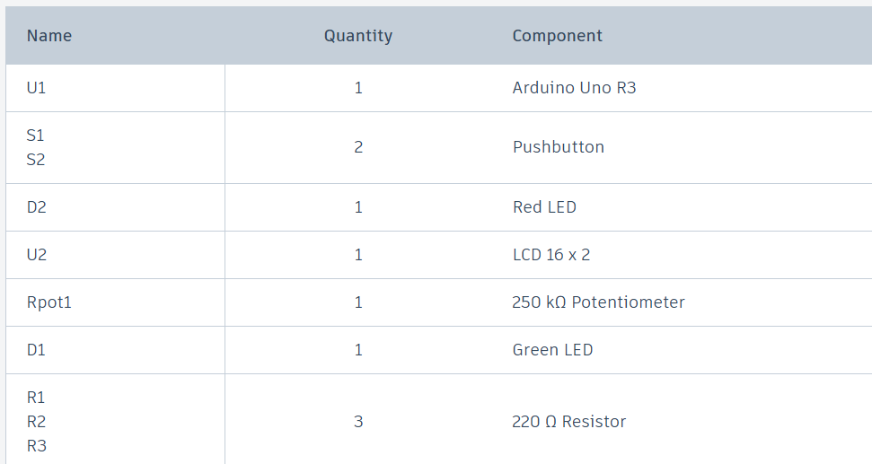
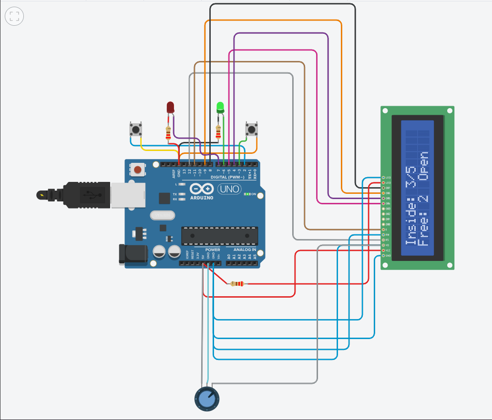
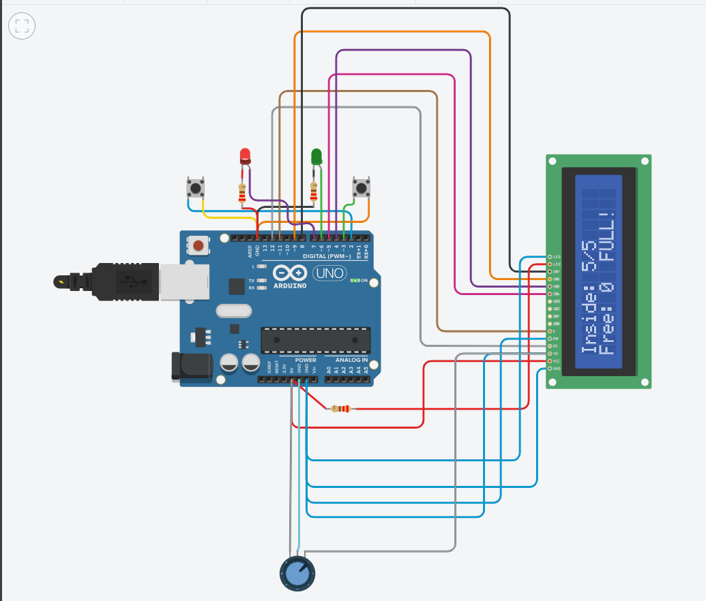
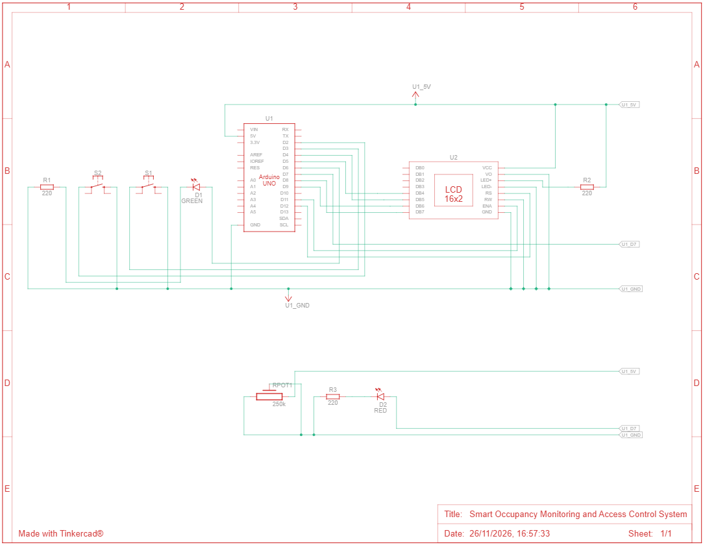

# P1 - Smart Occupancy Monitoring and Access Control System

## What the system does

An Arduino Uno counts how many people are inside a facility. Two push buttons
stand in for the door sensors: one press adds a person, the other removes one.
A 16x2 LCD shows the number of people inside on its first line and the number of
places still free plus **Open** or **FULL!** on the second, a green LED means
there is still room, and a red LED means the facility is full. It boots with a
short "Occupancy Tracker" splash, and every accepted or refused action is printed
to the Serial Monitor.

### 1. Hardware and pins

| Component | Quantity | Arduino pin | Purpose |
|---|---|---|---|
| Arduino Uno | 1 | - | controller |
| Push button (entry) | 1 | D2 (INPUT_PULLUP) | simulates a person entering |
| Push button (exit) | 1 | D3 (INPUT_PULLUP) | simulates a person leaving |
| Green LED | 1 | D6 (220 ohm to GND) | room still available |
| Red LED | 1 | D7 (220 ohm to GND) | facility full |
| 16x2 LCD | 1 | RS D12, EN D11, D4 D5, D5 D4, D6 D9, D7 D8 | occupancy display |
| Breadboard + jumpers | - | - | wiring |

The 16x2 module used in Tinkercad prints its pins as **GND, VCC, V0, RS, RW, E,
DB0-DB7, LED-, LED+** rather than the datasheet names, so the same pin appears
under two names:

| Datasheet name | Printed on the module | Connects to |
|---|---|---|
| VSS (pin 1) | GND | GND |
| VDD (pin 2) | VCC | 5V |
| V0 (pin 3) | V0 | GND, or the wiper of a potentiometer for contrast |
| D4-D7 (pins 11-14) | DB4-DB7 | D5, D4, D9, D8 |
| A (pin 15, backlight) | LED+ | 5V through 220 ohm |
| K (pin 16, backlight) | LED- | GND |

RW is tied to GND because the sketch only ever writes to the display.

### 2. Structures and dynamic memory

```c
typedef struct {
  int people_inside;
  int max_capacity;
  int total_entries;
  int total_exits;
  int rejected_entries;
  int rejected_exits;
} Occupancy;

typedef struct {
  unsigned long at_ms;
  char text[48];
} EventRecord;

typedef struct {
  EventRecord *items;
  int count;
  int capacity;
} EventLog;
```

Both records live on the heap:

- `calloc(1, sizeof(Occupancy))` allocates the occupancy record, and the program
  refuses to continue if the allocation fails.
- The event log starts with four entries and **doubles with `realloc`** every
  time it fills. The old block is only replaced after the new one is proven
  non-NULL, so a failed growth keeps the log intact and prints
  `[mem] could not grow event log`. The growth is silent when it succeeds; the
  logic test asserts it directly by checking that the capacity passed 4 slots
  after enough events, and `add_event()` bounds every copy to `text[48]`.

### 3. Pointers

Both records are pointers to heap memory held in globals, and every function
reaches the fields through them:

```c
Occupancy *occupancy = NULL;      // one heap record
EventLog  *events    = NULL;      // the log record, whose items live on the heap too

if (occupancy->people_inside < occupancy->max_capacity) {
  occupancy->people_inside++;
  occupancy->total_entries++;
}
```

`add_event()` writes through `events->items[events->count]`, so the log array is
reached by a pointer stored inside a struct rather than a fixed array - that is
what lets it be grown later. The string copy is a bounded loop that stops at the
buffer size, so an over-long message cannot overflow `text[48]`.

### 4. Non-blocking behaviour with millis()

`setup()` ends with a 1500 ms splash screen, which is the only `delay()` in the
sketch - it runs once, before the loop starts, and nothing can be missed during
it. After that, three timers run off `millis()` and `loop()` never blocks:

- **Debouncing.** Each button records the time of its last accepted press, and
  only a falling edge (LOW while `INPUT_PULLUP` holds the pin high) counts:

```c
if (entry_raw == LOW && !entry_was_pressed &&
    (now - last_entry_press) >= DEBOUNCE_MS) {   // 200 ms
  entry_was_pressed = 1;
  last_entry_press = now;
  ...
} else if (entry_raw == HIGH) {
  entry_was_pressed = 0;      // released: re-arm for the next press
}
```

- **Periodic LCD refresh.** `update_lcd()` returns immediately unless 500 ms have
  passed since the last repaint, so the screen is written on the sketch's own
  schedule instead of a blocking wait, and a press is never missed while the
  display is being updated.

- **Periodic statistics.** `print_stats()` prints the running totals to the
  Serial Monitor every ten seconds (`STATS_INTERVAL_MS`).

### 5. Rules the system enforces

| Situation | Behaviour |
|---|---|
| entry pressed, inside < capacity | count + 1, green LED on, entry logged |
| entry pressed, inside == capacity | **rejected**, count unchanged, red LED stays on, error printed |
| exit pressed, inside > 0 | count - 1, LEDs updated, exit logged |
| exit pressed, inside == 0 | **rejected**, count stays 0, error printed |

LED behaviour, exactly as the brief specifies:

| Occupancy | Green LED | Red LED |
|---|---|---|
| 0 people inside | ON | OFF |
| People inside, below maximum | ON | OFF |
| Maximum capacity reached | OFF | ON |
| Entry attempted while full | OFF | ON |

### 6. Serial Monitor output

Every event and every rejection is reported:

```
ENTRY #1 (inside: 1)
ENTRY #2 (inside: 2)
ENTRY #3 (inside: 3)
ENTRY #4 (inside: 4)
ENTRY #5 (inside: 5)
REJECTED (full, inside: 5)
EXIT #1 (inside: 4)
EXIT #2 (inside: 3)
EXIT #3 (inside: 2)
EXIT #4 (inside: 1)
EXIT #5 (inside: 0)
REJECTED (empty)
--- Stats ---
Inside: 0
Entries: 5
Exits: 5
Rejected in: 1
Rejected out: 1
Recent events (13 logged):
  6900 ms - EXIT #2 (inside: 3)
  7500 ms - EXIT #3 (inside: 2)
  8100 ms - EXIT #4 (inside: 1)
  8700 ms - EXIT #5 (inside: 0)
  9300 ms - REJECTED (empty)
--------------
```

The statistics block prints itself every ten seconds and closes with the last
five entries of the event log, so the dynamically grown log is not just filled and
forgotten - it is read back out. The count includes the "System started" entry
written during setup, which is why 13 events are logged after 12 button actions.

### 7. How the logic was tested without hardware

The sketch cannot run on a PC, so `docs/evidence/occupancy_sim_test.cpp`
supplies a stand-in Arduino API (`pinMode`, `digitalWrite`, `digitalRead`,
`millis`, `Serial`, and a `LiquidCrystal` stub in
`docs/evidence/LiquidCrystal.h`), includes `occupancymonitor.ino` **verbatim**,
and then drives `setup()` and `loop()` with simulated button presses.

```
g++ -Wall -std=c++17 -I docs/evidence docs/evidence/occupancy_sim_test.cpp -o /tmp/occ
/tmp/occ
```

Result: **32 checks, 0 failures** (`docs/evidence/occupancy_test_output.txt`),
covering:

- the empty facility state: both LEDs, `Inside: 0/5` and `Free: 5  Open`
- three entries, then filling to capacity, with `Free: 2` after three people and
  the red LED switching on at five
- an entry rejected while full, with the count unchanged
- a second press 50 ms later being ignored (debounce)
- exits driven down to zero, then an exit rejected, and the display returning to
  `Free: 5  Open`
- the display staying stale 100 ms after a change and catching up at 500 ms,
  which proves the repaint really is on its own `millis()` timer
- the event log expanding past its first four slots and holding one record per
  accepted or refused action

The test also asserts the exact LCD text (`Inside: 3/5`, `Free: 2`, `FULL!`,
`Open`), so a formatting mistake in the display would fail the test rather than
pass silently.

### 7b. Seeing the display without hardware

`docs/evidence/lcd_preview.cpp` uses the same stand-ins but checks nothing: it
presses the buttons through a full session and draws what the 16x2 display and
the two LEDs would show, with the Serial Monitor output beside each step.

```
g++ -Wall -std=c++17 -I docs/evidence docs/evidence/lcd_preview.cpp -o /tmp/lcd
/tmp/lcd
```

The captured run is `docs/evidence/lcd_preview_output.txt`. Each step shows the
button pressed, the Serial Monitor line it produced, the two LCD rows and the
state of both LEDs, so the two limits the brief asks for - capacity never
exceeded, occupancy never negative - are visible rather than only asserted.

The sketch is also compiled for the real ATmega328P with the Arduino toolchain
(`arduino-cli compile --fqbn arduino:avr:uno`): 8078 bytes of program storage
(25% of the Uno) and 388 bytes of global memory (18%), with no warnings from the
sketch itself.

### 8. The Tinkercad build

The circuit was built and simulated in Tinkercad. The bill of materials is one
Arduino Uno R3, two pushbuttons, one green LED, one red LED, a 16x2 LCD, a 250 kΩ
potentiometer for contrast and three 220 Ω resistors - one for each LED and one for
the LCD backlight:



With three people inside, the first line reads `Inside: 3/5` and the second line
`Free: 2  Open`, with the green LED lit:



Once the fifth person enters, the same two lines read `Inside: 5/5` and
`Free: 0  FULL!`, the green LED goes out and the red LED comes on:



Both states match the thresholds in the code exactly (the display switches at
`people_inside >= max_capacity`, the same comparison that drives the LEDs), which is
the visual confirmation of everything the logic test asserts numerically.

Tinkercad also exports the schematic of the same build, which is where the pin map
of section 1 can be checked connection by connection - note `U1_5V`, `U1_GND` and
`U1_D7` on the right-hand nets feeding the display and the red LED branch:



### Deliverables checklist for Project 1

- [x] Arduino source code: `occupancymonitor.ino`
- [x] Structures, pointers, dynamic memory and `free()`-safe design: section 2 and 3
- [x] Non-blocking debounce and LCD refresh with `millis()`: section 4
- [x] LED and error-handling rules: sections 5 and 6
- [x] Off-hardware proof of the logic: section 7, 32 checks passing
- [x] Tinkercad circuit, its two display states, the schematic and the BOM: section 8
